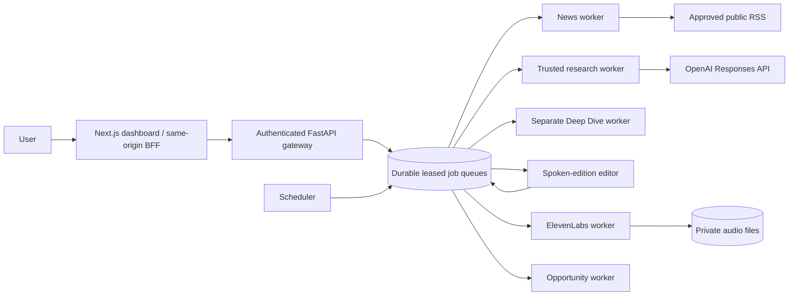

# Architecture decision: single-host foundation

Seven independent worker processes and one API process can be restarted separately. The scheduler only enqueues; it never performs retrieval. Research and Deep Dive have separate queues. Queue inserts are durable SQLite transactions, claims use an immediate transaction, expired leases can be recovered, and failed work backs off into a dead-letter state after four attempts. Event names have `.v1` suffixes. Execution IDs deduplicate scheduler runs and audio requests. Consumers must tolerate at-least-once delivery.

This is a **single-host deployment grouping**, using per-domain SQLite files and a shared SQLite broker as a low-cost alternative to PostgreSQL/Redis. It is not a horizontally distributed production deployment. Persistence initialisation is the first migration (`documents` and `jobs`, created idempotently). No external migration runner is required at this version.

Known boundary gaps: the current API and workers use shared repository functions, and voice updates a completed record's audio status. Database access is not yet isolated by service credentials. This does not satisfy the specification's full independent data ownership requirement. A subsequent production migration must add PostgreSQL service-owned schemas, an outbox/inbox and API/event-only cross-domain updates. Do not scale multiple hosts against these SQLite files or place them on NFS.

The shared host, volume, broker and gateway remain failure points. A long publisher request does not block the research worker, but a large number of publishers can delay news. One worker per queue is the supported configuration. Leases last 180 seconds and workers renew them every 30 seconds during long news/audio jobs. Stale completion and renewal are fenced by attempt. Field-level status patches preserve concurrent editorial fields, but full multi-worker domain-write fencing and a transactional outbox remain production work.

## Contracts

- `briefing.scheduled.v1`: news queue, edition ID, title, scheduled ISO time.
- `briefing.text.ready.v1`: opportunities queue, briefing ID.
- `research.requested.v1`: research/deep queue, ID, question, mode, conversation ID.
- `audio.generation.requested.v1`: voice queue, originating domain, completed text and ID.

These are the implemented events; the broader master-spec event catalogue is not yet implemented. The gateway exposes typed request models through FastAPI OpenAPI. Worker status and bounded job history are available through `/api/operations`.

## Scheduling and evidence

Oman editions run at 07:00, 11:00, 15:00 and 21:00 in `Asia/Muscat`. Startup catches up today's elapsed slots; older missed days are not replayed. Source feed items need a usable publication date. Retrieval is bounded to 2 MB per feed with no redirects. The last two days are eligible; identical URL/content versions already published are excluded. Changed content can be selected again. Rankings are explicitly relevance rankings, never invented readership counts.

The evidence verifier accepts only exact bounded quotations from supplied documents and counts **reviewed** independent source groups. It is unit tested, but not yet wired into an automated broader-web claim decomposition pipeline. AI research output is never promoted to Confirmed. Trusted retrieval is lexical, with conversation context; semantic/hybrid retrieval is future work.

## KUMAIL listening contracts

`presentation.requested.v1` uses the separate editor queue. The editor accepts a completed record reference, creates a validated `spoken-v1` presentation and queues narration. Stories preserve exact source IDs in metadata; spoken fields strip URLs, source hashes and report labels. Evidence remains in the written record. The voice worker accepts the completed script and returns ordered audio segments with story IDs, allowing the browser to bind an interruption to the chapter actually playing. Long segments are sentence-chunked and cached without truncation.

The source collector now retrieves up to four feeds concurrently. Each enabled feed supplies up to three new candidates. The earlier publisher-family and eight-story caps are removed. URL/headline rules and optional validated AI event grouping consolidate overlap; these remain heuristics, not independent verification. All distinct groups are edited in bounded batches. Private interaction events provide bounded, decaying topic-order adjustments after repeated engagement, separately from explicit interests.

The browser starts the microphone only on an explicit user gesture. It pauses playback before listening, sends the current briefing/article context to research and preserves the briefing chapter/time while playing an answer. No scheduled completion triggers playback. Always-on wake words, full-duplex acoustic interruption, wider-web research and autonomous delivery remain outside this release.

The editor and voice processes each reserve a separate consumer for conversational answers (`answer_editor` and `answer_voice`). A full scheduled edition cannot occupy those answer slots. They share the service process and underlying host; this is resource reservation, not a claim of complete infrastructure isolation.
